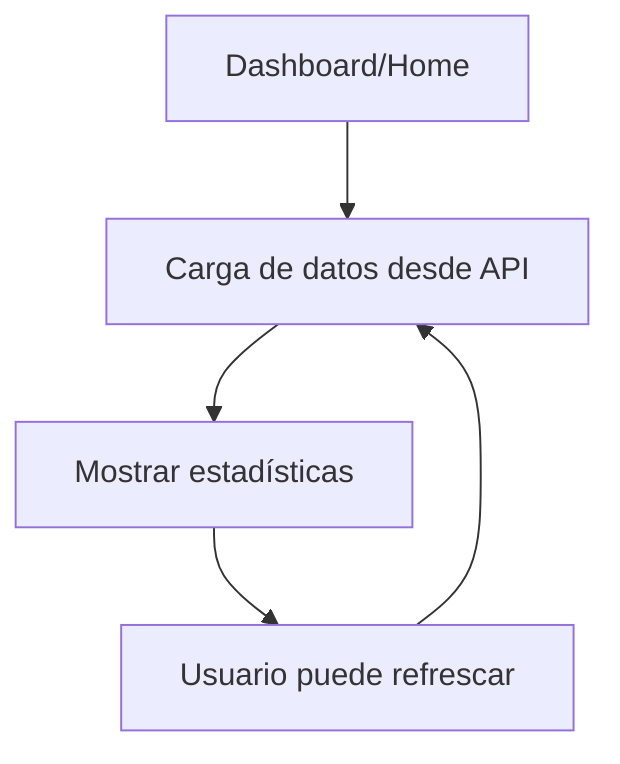

## 1. Product Overview
Dashboard web para visualizar estadísticas de contenido multimedia de tres plataformas: Docines, Plusmovie y Dooplex. Muestra conteos de películas, series y animes en tiempo real.

Permite a los administradores y usuarios monitorear el inventario de contenido multimedia de forma centralizada y visual.

## 2. Core Features

### 2.2 Feature Module
Nuestro dashboard consiste en las siguientes páginas principales:
1. **Dashboard/Home**: visualización de estadísticas, tarjetas de conteo por plataforma, gráficos de distribución.

### 2.3 Page Details
| Page Name | Module Name | Feature description |
|-----------|-------------|---------------------|
| Dashboard/Home | Header | Mostrar logo y título del dashboard |
| Dashboard/Home | Tarjetas de estadísticas | Mostrar contadores de películas, series y animes para cada plataforma (Docines, Plusmovie, Dooplex) |
| Dashboard/Home | Gráficos | Visualizar distribución de contenido con gráficos de barras o circulares |
| Dashboard/Home | Actualización | Actualizar datos automáticamente al cargar la página y proporcionar botón de refresco manual |
| Dashboard/Home | Estado de carga | Mostrar indicador de carga mientras se obtienen los datos de la API |
| Dashboard/Home | Manejo de errores | Mostrar mensaje de error si la API no responde o hay problemas de conexión |

## 3. Core Process
El usuario accede al dashboard y ve inmediatamente las estadísticas de contenido. El flujo es simple: carga la página → se muestran las estadísticas → el usuario puede refrescar los datos manualmente.

## 4. User Interface Design

### 4.1 Design Style
- Colores primarios: Azul oscuro (#1e40af) y gris claro (#f3f4f6)
- Colores secundarios: Verde (#10b981) para números positivos, rojo (#ef4444) para errores
- Estilo de botones: Redondeados con sombra sutil
- Tipografía: Inter o system-ui, tamaños 16px para texto normal, 24-32px para títulos
- Layout: Diseño de cuadrícula (grid) con tarjetas responsivas
- Iconos: Emoji o iconos de lucide-react para representar películas 🎬, series 📺, animes 🎭

### 4.2 Page Design Overview
| Page Name | Module Name | UI Elements |
|-----------|-------------|-------------|
| Dashboard/Home | Header | Logo centrado, título "Dashboard de Contenido" en fuente 32px bold |
| Dashboard/Home | Tarjetas de estadísticas | Grid de 3 columnas en desktop, 1 columna en móvil, tarjetas con bordes redondeados y sombra |
| Dashboard/Home | Gráficos | Gráfico de barras horizontal mostrando distribución por plataforma, colores distintivos para cada categoría |
| Dashboard/Home | Botón refrescar | Botón azul con icono de refresco, posicionado en esquina superior derecha |
| Dashboard/Home | Estado de carga | Spinner centrado con texto "Cargando estadísticas..." |
| Dashboard/Home | Mensaje de error | Alerta roja con icono de advertencia y texto descriptivo del error |

### 4.3 Responsiveness
Diseño desktop-first con adaptación móvil. Las tarjetas se apilan verticalmente en pantallas pequeñas. Touch-friendly con áreas de clic mínimas de 44x44px.

### 4.4 3D Scene Guidance
No aplica para este proyecto.