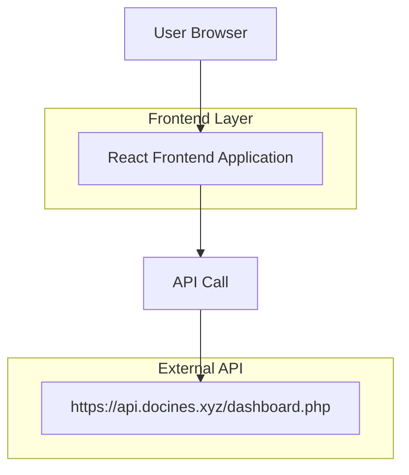

## 1. Architecture design



## 2. Technology Description
- Frontend: React@18 + tailwindcss@3 + vite
- Initialization Tool: vite-init
- Backend: None (consumo directo de API externa)

## 3. Route definitions
| Route | Purpose |
|-------|---------|
| / | Dashboard principal, muestra las estadísticas de contenido |

## 4. API definitions
### 4.1 External API Integration

Dashboard statistics endpoint
```
GET https://api.docines.xyz/dashboard.php
```

Request:
- No requiere parámetros
- Headers: Accept: application/json

Response:
| Param Name| Param Type  | Description |
|-----------|-------------|-------------|
| success   | boolean     | Estado de la respuesta |
| data      | object      | Objeto con estadísticas de las tres plataformas |

Example response:
```json
{
  "success": true,
  "data": {
    "docines": {
      "series": 120,
      "movies": 540
    },
    "plusmovie": {
      "movies": 800,
      "series": 200
    },
    "dooplex": {
      "movies": 300,
      "series": 90,
      "animes": 40
    }
  }
}
```

## 5. Server architecture diagram
No aplica - El proyecto es frontend-only que consume API externa.

## 6. Data model
No aplica - No hay base de datos local, solo consumo de API externa.